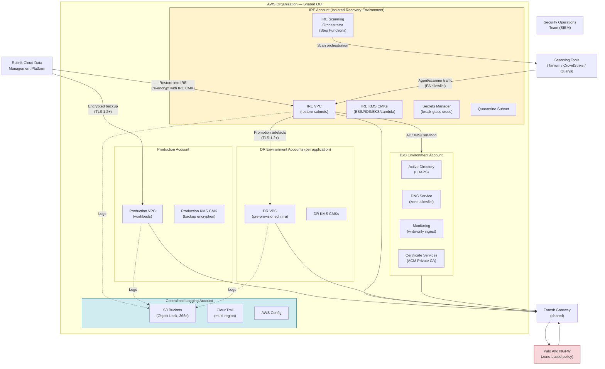
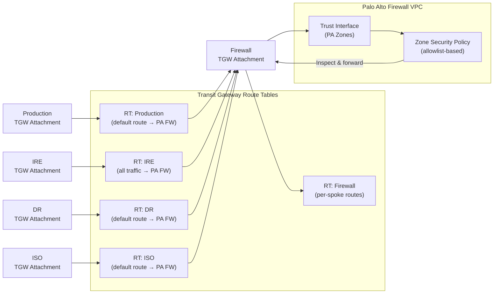
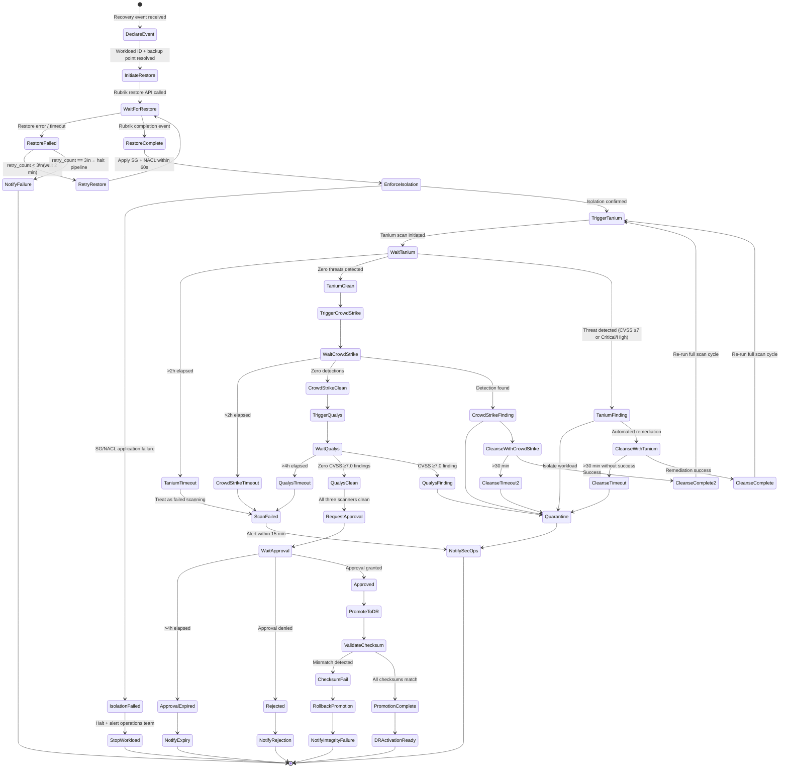
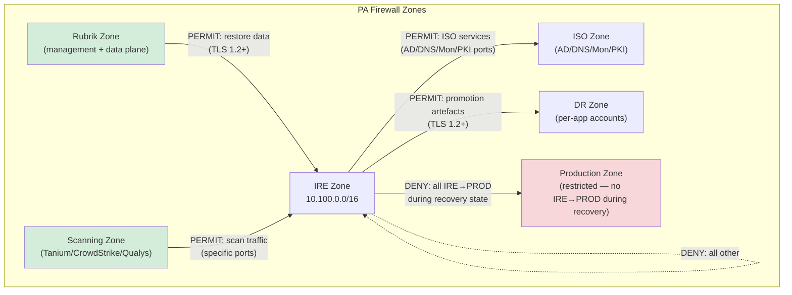
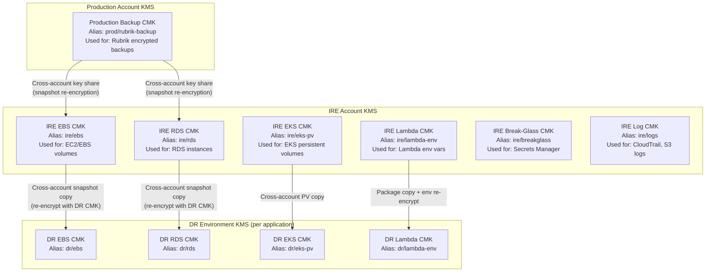
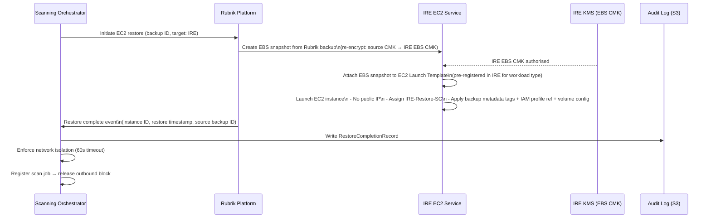
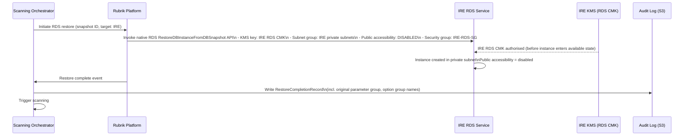
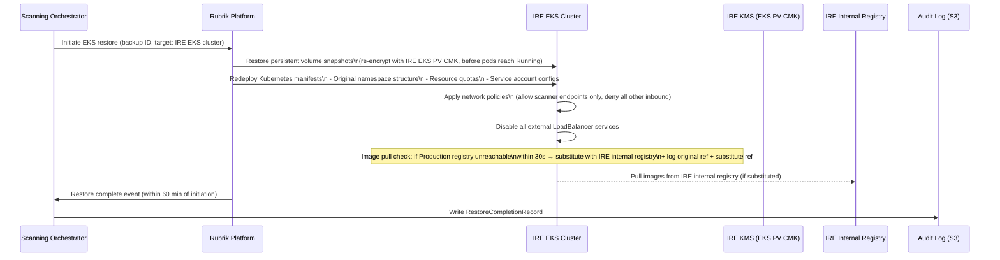
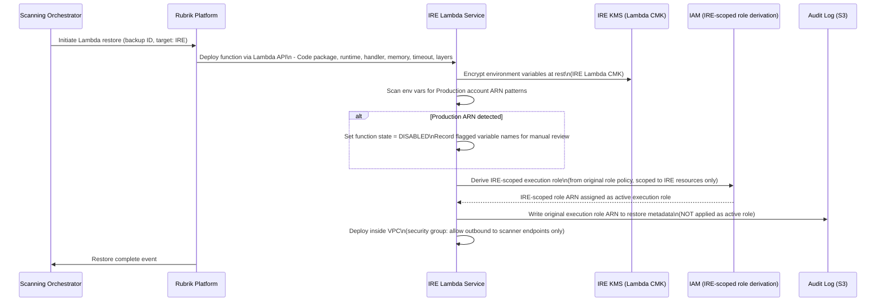

# Design Document

## AWS Cyber Recovery — Isolated Recovery Environment (IRE)

---

## Overview

This document describes the technical design for an AWS Cyber Recovery solution centred on an Isolated Recovery Environment (IRE). The solution protects production workloads through Rubrik backup, restores them into a strictly isolated AWS account for security scanning and validation, and promotes clean workloads to pre-provisioned Disaster Recovery (DR) environment accounts. Foundational services (Active Directory, DNS, monitoring, certificate services) are provided by a dedicated ISO Environment consumed securely by IRE workloads.

The design covers multi-account AWS architecture, network isolation, identity and access management, workload-specific recovery pipelines, security scanning integration, encryption key hierarchy, compliance logging, and promotion to DR. It addresses all requirements in `requirements.md` (Requirements 1–18).

**Key design principles:**

- Every network path into and out of the IRE traverses the Palo Alto Firewall — no exceptions.
- No corporate SSO federation in the IRE; all human access is via break-glass accounts with MFA.
- Encryption at rest and in transit is mandatory across all environments using AWS KMS CMKs.
- The recovery pipeline is fully automated with a single mandatory human approval gate before DR promotion.
- All actions are captured in immutable, centralised audit logs retained for a minimum of 365 days.

---

## Architecture

### Multi-Account Structure

The solution spans six AWS account types within the same AWS Organization and Organizational Unit (OU):

| Account | Purpose |
|---|---|
| **Production Account** | Source workloads protected by Rubrik backup |
| **IRE Account** | Isolated Recovery Environment — restore, scan, validate |
| **DR Environment Accounts** | One per application — pre-provisioned DR target |
| **ISO Environment Account** | Foundational services (AD, DNS, monitoring, PKI) |
| **Centralised Logging Account** | Immutable audit log storage |
| **Rubrik Management Account** | Rubrik Cloud Data Management control plane |

All accounts reside in the same OU so that Service Control Policies (SCPs) applied at the OU level are consistently enforced across Production, IRE, and DR accounts (Requirement 2.1, 2.2).

### Overall Multi-Account Architecture



### Transit Gateway and Firewall Topology



All IRE-bound and IRE-originating traffic is routed exclusively through the Palo Alto Firewall via the Transit Gateway (Requirement 2.3). The firewall has no default-permit rules; all traffic must match an explicit allowlist entry (Requirement 2.4, 15.1).

---

## Components and Interfaces

### IRE Scanning Orchestrator

The IRE Scanning Orchestrator is the central coordination component for the recovery pipeline. It is implemented as an **AWS Step Functions state machine** within the IRE account.

**Responsibilities:**
- Receives recovery event declarations and drives the end-to-end pipeline.
- Triggers Rubrik restore operations via the Rubrik REST API.
- Enforces sequential scanning: Tanium → CrowdStrike → Qualys.
- Evaluates scan results against CVSS thresholds and quarantine triggers.
- Manages the promotion approval gate (human approval via SNS/EventBridge).
- Invokes the Promotion Service for validated workloads.
- Records all pipeline events in the IRE Workflow Registry (DynamoDB).

**Interfaces:**

| Interface | Protocol | Direction |
|---|---|---|
| Rubrik REST API | HTTPS / TLS 1.2+ | Orchestrator → Rubrik |
| Tanium API | HTTPS / TLS 1.2+ | Orchestrator → Tanium |
| CrowdStrike API | HTTPS / TLS 1.2+ | Orchestrator → CrowdStrike |
| Qualys API | HTTPS / TLS 1.2+ | Orchestrator → Qualys |
| SNS Approval Topic | HTTPS | Orchestrator → Recovery Authority |
| DynamoDB (Workflow Registry) | AWS SDK | Orchestrator → DynamoDB |
| Centralised S3 (Audit Logs) | AWS SDK / S3 VPC Endpoint | Orchestrator → S3 |

### IRE Workflow Registry

A **DynamoDB table** in the IRE account that records every active and historical recovery pipeline execution. Used to distinguish authorised recovery activity from out-of-band modifications (Requirement 16.4).

**Schema:**

| Attribute | Type | Description |
|---|---|---|
| `workflowId` | String (PK) | UUID for the pipeline execution |
| `workloadId` | String (SK) | Workload identifier |
| `state` | String | Current pipeline state |
| `initiatedBy` | String | IAM principal ARN |
| `startTime` | String (ISO 8601) | Pipeline start timestamp |
| `lastUpdated` | String (ISO 8601) | Last state transition timestamp |
| `scanResults` | Map | Per-scanner results (status, timestamp) |
| `approvalRequestId` | String | Approval gate request identifier |
| `promotionTimestamp` | String | Promotion completion timestamp |

### Promotion Service

An **AWS Lambda function** (IRE-scoped execution role) that executes the final promotion of validated workloads from IRE to the DR Environment. Invoked by the Scanning Orchestrator state machine after human approval.

**Responsibilities:**
- Copies artefacts (EBS snapshots, ECR images, Lambda packages) from IRE to DR Environment using TLS 1.2+.
- Re-encrypts artefacts using the DR Environment's KMS CMK.
- Validates checksums before confirming promotion.
- Rolls back partial transfers on failure.
- Records the promotion event in the centralised audit log.

### Break-Glass Account Manager

A combination of **AWS Secrets Manager**, **IAM Identity Centre (disabled for federation)**, and **EventBridge rules** that manages break-glass credentials.

**Responsibilities:**
- Stores break-glass credentials encrypted with the dedicated IRE KMS CMK.
- Enforces MFA on all break-glass account logins.
- Detects session end events (CloudTrail: ConsoleLogin with sessionEnd) and triggers rotation within 1 hour.
- Rotates credentials on a schedule not exceeding 90 days.

---

## Data Models

### Recovery Pipeline State

```
WorkflowState:
  DECLARED           — Recovery event received, pipeline initialised
  RESTORE_PENDING    — Rubrik restore initiated, awaiting completion
  RESTORE_COMPLETE   — Workload restored into IRE
  SCANNING           — Sequential scan cycle in progress
  SCAN_COMPLETE      — All three scanners returned clean
  QUARANTINED        — Workload isolated due to scan finding
  CLEANSING          — Automated remediation in progress
  RESCAN_PENDING     — Post-cleansing rescan initiated
  APPROVAL_PENDING   — Awaiting human approval gate
  APPROVAL_EXPIRED   — Approval not received within 4 hours
  PROMOTING          — Artefact transfer to DR Environment in progress
  PROMOTED           — Workload successfully in DR Environment
  FAILED             — Terminal failure state
```

### Scan Result Record

```
ScanResult:
  workflowId:     String   — Pipeline execution identifier
  workloadId:     String   — Workload identifier
  scanner:        Enum     — TANIUM | CROWDSTRIKE | QUALYS
  initiatedAt:    DateTime — Scan trigger timestamp
  completedAt:    DateTime — Result received timestamp
  status:         Enum     — CLEAN | FINDING | TIMEOUT | ERROR
  findings:       List     — List of Finding objects
  reportLocation: String   — S3 URI of the full scan report

Finding:
  id:           String  — Scanner-native finding identifier
  cvssScore:    Float   — CVSS v3 score (0.0–10.0)
  severity:     Enum    — CRITICAL | HIGH | MEDIUM | LOW | INFO
  description:  String  — Finding description
  remediated:   Boolean — Whether automated remediation was applied
  remediatedAt: DateTime
```

### Backup Completion Record (Requirement 1.3)

```
BackupCompletionRecord:
  workloadId:     String   — Registered workload identifier
  timestamp:      DateTime — Completion time (second precision)
  backupSizeBytes: Long    — Backup size in bytes
  kmsKeyArn:      String   — KMS CMK ARN used for encryption
  backupJobId:    String   — Rubrik job identifier
  status:         Enum     — SUCCESS | PARTIAL | FAILED
```

### Restore Completion Record (Requirement 4.3)

```
RestoreCompletionRecord:
  workloadId:          String   — Workload identifier
  backupTimestamp:     DateTime — Source backup point-in-time
  restoreDuration:     Long     — Duration in seconds
  targetResourceIds:   List     — IRE resource identifiers (instance IDs, etc.)
  kmsKeyArn:           String   — IRE CMK ARN used for re-encryption
  workflowId:          String   — Pipeline execution identifier
```

### Promotion Audit Record (Requirement 11.4)

```
PromotionAuditRecord:
  workloadId:           String   — Workload identifier
  promotionTimestamp:   DateTime — Promotion completion time
  approvingAuthority:   String   — IAM principal ARN of approver
  scanResultsSummary:   Map      — Per-scanner clean confirmation
  checksumValidated:    Boolean  — Whether checksum matched
  drResourceIds:        List     — DR Environment resource identifiers
  workflowId:           String   — Pipeline execution identifier
```

---

## Recovery Pipeline State Machine Design

The recovery pipeline is implemented as a Step Functions **Express Workflow** (for high-throughput parallel execution) with the following state transitions:



### 6-Hour RTO Checkpoint (Requirement 17.3)

A parallel timer branch runs alongside the main pipeline. If the workload has not reached the `QualysClean` state within 6 hours of `InitiateRestore`, an EventBridge rule fires a Lambda that notifies the recovery team and incident manager with an updated estimated completion time.

### Parallel Workload Support (Requirement 17.4)

Each pipeline execution is an independent Express Workflow instance keyed by `workflowId`. The 8-hour RTO is measured independently per workload from its individual `InitiateRestore` timestamp. The IRE Workflow Registry records and tracks all concurrent executions.

---

## Network Design

### IRE VPC Design

```
IRE VPC: 10.100.0.0/16

Subnets:
  Restore Subnet A (AZ-a):    10.100.1.0/24  — Private, workloads land here
  Restore Subnet B (AZ-b):    10.100.2.0/24  — Private, workloads land here
  Quarantine Subnet (AZ-a):   10.100.10.0/24 — Isolated subnet for failed workloads
  Management Subnet (AZ-a):   10.100.20.0/24 — Orchestrator Lambda, Step Functions ENIs
  Endpoint Subnet (AZ-a):     10.100.30.0/24 — VPC Interface Endpoints
  Endpoint Subnet (AZ-b):     10.100.31.0/24 — VPC Interface Endpoints

Route Tables:
  Restore RT:      Default route → TGW attachment (all traffic via PA FW)
  Quarantine RT:   No default route (complete isolation)
  Management RT:   Default route → TGW attachment
  Endpoint RT:     Local routes only
```

**Key network rules:**

- No Internet Gateway or NAT Gateway in the IRE VPC (Requirement 2.5, 15.5).
- No Elastic IPs on any restored workload (Requirement 15.5).
- VPC endpoints for S3, KMS, SSM, and ECR enforce boundary using endpoint policies that deny requests targeting resources outside the IRE account (Requirement 15.8).

### Network ACLs

| Subnet | Inbound Allow | Outbound Allow |
|---|---|---|
| Restore Subnets | Tanium, CrowdStrike, Qualys scanner CIDRs only | ISO Environment service CIDRs (AD/DNS/Mon/PKI) |
| Quarantine Subnet | Deny all | Deny all |
| Management Subnet | VPC-internal only | TGW (for API calls via VPC endpoints) |

### Security Groups

**IRE-Restore-SG** (applied to all restored EC2 instances — Requirement 5.3):

| Rule | Direction | Source/Dest | Ports |
|---|---|---|---|
| Allow Tanium | Inbound | Tanium scanner CIDR | TCP 17472, 17486 |
| Allow CrowdStrike | Inbound | CrowdStrike CIDR | TCP 443 |
| Allow Qualys | Inbound | Qualys scanner CIDR | TCP 443, ICMP |
| Deny all other | Inbound | 0.0.0.0/0 | All |
| Allow ISO-AD | Outbound | ISO AD CIDR | TCP/UDP 389, 636 |
| Allow ISO-DNS | Outbound | ISO DNS CIDR | TCP/UDP 53 |
| Allow ISO-Mon | Outbound | ISO Monitoring CIDR | TCP 443 |
| Deny all other | Outbound | 0.0.0.0/0 | All |

**IRE-Quarantine-SG** (applied on quarantine — Requirement 9.5):

All inbound and outbound traffic denied.

**IRE-RDS-SG** (applied to restored RDS instances — Requirement 6.3):

Allows inbound on engine default port from scanner CIDR ranges only. No outbound except ISO services.

### Palo Alto Firewall Zone Policies



All firewall rules are allowlist-based. Any traffic not matching an explicit permit rule is denied and dropped (Requirement 2.4, 15.1). Firewall logs all allowed and denied flows with source IP, destination IP, port, protocol, and action; retained for a minimum of 90 days (Requirement 15.4).

During steady-state (no active recovery), route entries to Production subnets are absent from IRE route tables and no established sessions exist between IRE and Production (Requirement 2.6).

---

## Identity and Access Management Design

### Break-Glass Account Structure (Requirements 3.1–3.8)

```
IAM Structure:
  Root Account:
    - MFA enforced
    - All access keys disabled (Requirement 18.5)
    - SSO federation DISABLED at account level

  Break-Glass Users (IAM Users — no federation):
    bg-recovery-engineer-01
    bg-recovery-engineer-02
    bg-security-admin-01

  Break-Glass Group: bg-recovery-operators
    - MFA required (IAM policy: aws:MultiFactorAuthPresent == true)
    - IP condition: aws:SourceIp matches approved IP range list
    - Attached policy: RecoveryOperatorPolicy (least-privilege)
```

**Credential storage (Requirement 3.2):**

Break-glass credentials are stored in AWS Secrets Manager in the IRE account. Each secret is encrypted with a dedicated KMS CMK (`ire-breakglass-cmk`). Secrets Manager resource policy restricts access to the break-glass account manager Lambda and designated IRE orchestration roles.

**Rotation schedule (Requirements 3.7, 3.8):**

- Scheduled rotation: Every 90 days (Secrets Manager rotation Lambda).
- Post-use rotation: CloudTrail → EventBridge rule detects `ConsoleLogin` event from break-glass IAM user → triggers Secrets Manager rotation Lambda within 1 hour of session end.

**MFA enforcement (Requirement 3.4):**

IAM policy attached to `bg-recovery-operators` group:

```json
{
  "Effect": "Deny",
  "Action": "*",
  "Resource": "*",
  "Condition": {
    "BoolIfExists": {
      "aws:MultiFactorAuthPresent": "false"
    }
  }
}
```

**IP restriction (Requirement 3.5):**

```json
{
  "Effect": "Deny",
  "Action": "sts:AssumeRole",
  "Resource": "*",
  "Condition": {
    "NotIpAddress": {
      "aws:SourceIp": ["<approved-cidr-1>", "<approved-cidr-2>"]
    }
  }
}
```

### IAM Permission Boundaries (Requirement 18.1, 18.2)

All IAM roles in the IRE account have a permission boundary policy attached that explicitly denies:

- All IAM management actions (`iam:*`) unless the role is listed in the IRE role registry.
- All S3 log bucket actions (`s3:*` on `arn:aws:s3:::ire-centralized-logs-*`).
- All CloudTrail management actions (`cloudtrail:*`).
- All IAM wildcard actions (`"Action": "*"`) — enforced via SCP at OU level (Requirement 18.2).
- All AWS API calls from outside the IRE VPC — enforced via IAM condition `aws:SourceVpc` (Requirement 18.3).

**Designated IRE orchestration roles** (exempt from above denies, listed in IRE role registry):

| Role | Purpose |
|---|---|
| `ire-scanning-orchestrator-role` | Step Functions execution role |
| `ire-promotion-service-role` | Promotion Lambda execution role |
| `ire-breakglass-rotation-role` | Credential rotation Lambda |
| `ire-rubrik-restore-role` | Rubrik restore operations |
| `ire-config-recorder-role` | AWS Config recorder |

**New IAM role creation alert (Requirement 18.4):**

EventBridge rule on CloudTrail event `CreateRole` → SNS notification to security operations team within 15 minutes.

### SCP Design (Requirement 2.2)

Applied at the OU level, the following SCPs are enforced on all accounts in the OU:

| SCP | Effect |
|---|---|
| Deny direct internet egress from IRE subnets | Deny `ec2:CreateInternetGateway`, `ec2:AttachInternetGateway` in IRE account |
| Deny cross-account VPC peering outside TGW | Deny `ec2:CreateVpcPeeringConnection` |
| Deny IAM privilege escalation | Deny `iam:CreatePolicyVersion`, `iam:SetDefaultPolicyVersion`, `iam:AttachRolePolicy` unless by orchestration roles |
| Deny IAM wildcard actions | Deny any policy containing `"Action": "*"` |

---

## KMS Encryption Design (Requirements 14.1–14.6)

### KMS CMK Hierarchy



**Key policy design (Requirement 14.4):**

Each CMK key policy follows:

```json
{
  "Statement": [
    {
      "Effect": "Allow",
      "Principal": { "AWS": ["<authorised-role-arn-1>", "<authorised-role-arn-2>"] },
      "Action": ["kms:Encrypt", "kms:Decrypt", "kms:GenerateDataKey", "kms:DescribeKey"],
      "Resource": "*"
    },
    {
      "Effect": "Deny",
      "Principal": "*",
      "Action": "kms:*",
      "Resource": "*",
      "Condition": {
        "StringNotEquals": {
          "aws:PrincipalArn": ["<authorised-role-arn-1>", "<authorised-role-arn-2>"]
        }
      }
    }
  ]
}
```

**Key rotation (Requirement 14.3):** Automatic annual rotation enabled on all CMKs.

**Key deletion alert (Requirement 14.6):** EventBridge rule on `ScheduleKeyDeletion` → SNS alert to security team within 24 hours. All CMKs are configured with a 30-day deletion waiting period.

**CloudTrail KMS data event logging (Requirement 14.5):** CloudTrail trails in both IRE and DR accounts enable KMS data events, recording `Encrypt`, `Decrypt`, `GenerateDataKey`, `Sign`, and `Verify` with key ARN and calling principal.

---

## Workload-Specific Recovery Designs

### EC2/EBS Recovery



**Key design decisions:**

- EBS snapshots are created within the IRE account using the cross-account share of the Production KMS CMK for decryption, then immediately re-encrypted with the IRE EBS CMK (Requirement 5.2, 4.2).
- EC2 launch templates are pre-registered in the IRE account per workload type; the restore process selects the matching template by workload type tag (Requirement 5.1).
- Instance tags, IAM instance profile reference, and volume attachment configuration are read from backup metadata and applied identically to the restored instance (Requirement 5.4).
- If EC2 restore fails, an alert is raised to the recovery team within 5 minutes (Requirement 5.5).

### RDS Recovery



**Key design decisions:**

- The IRE RDS CMK is applied at restore time before the instance enters an `available` state (Requirement 6.2).
- Public accessibility is set to `disabled` before the instance transitions to available (Requirement 6.4).
- Original parameter group name and option group name are written to the restore metadata record, retrievable via the recovery job identifier (Requirement 6.6).
- Engine version incompatibility failures trigger an alert within 5 minutes with instance ID, snapshot ID, detected engine version, and incompatibility reason (Requirement 6.5).

### EKS Recovery



**Key design decisions:**

- All persistent volumes are encrypted with the IRE EKS PV CMK before pods reach a Running state (Requirement 7.2).
- Kubernetes NetworkPolicies are applied to permit only inbound traffic from scanning tool endpoints (Requirement 7.3).
- Container registry substitution: if a manifest references a Production registry image that does not respond within 30 seconds, the IRE-approved internal registry is substituted and the substitution is logged (Requirement 7.5).
- External LoadBalancer services are disabled immediately on restore and remain disabled until post-promotion (Requirement 7.6).
- On partial failure (PV or manifest), all partially restored resources are removed from the cluster and a failure report is generated (Requirement 7.7).

### Lambda Recovery



**Key design decisions:**

- Lambda environment variables are encrypted at rest with the IRE Lambda CMK (Requirement 8.2).
- The original execution role ARN is recorded in restore metadata but never applied as the active role (Requirement 8.4). An IRE-scoped execution role is derived and applied instead (Requirement 8.5).
- Environment variable scanning for Production ARN patterns: any variable whose value matches the Production account ID ARN pattern causes the function to be set to `DISABLED` until all flagged variables are updated or acknowledged by a recovery engineer (Requirement 8.6).
- On partial deployment failure, remaining function resources are left in a `disabled` state and the failure is surfaced (Requirement 8.7).

---

## Security Scanning Integration Design (Requirements 9.1–9.9)

### Scanning Sequence and Orchestration

The Scanning Orchestrator enforces the mandatory sequence: **Tanium → CrowdStrike → Qualys**. Each scanner must return a clean result before the next is triggered.

### Tanium Integration (Requirements 9.2, 10.1, 10.3)

- **Deployment model:** Tanium Agent pre-installed on EC2 AMIs and EKS node group AMIs in the IRE. On workload restore, the agent phone-home to the Tanium Server is allowed through the IRE-Restore-SG inbound rules.
- **Scan trigger:** Orchestrator calls Tanium REST API to initiate a scan on the specific endpoint (by IP/hostname).
- **Time limit:** 2 hours. If no result is received within 2 hours, the workload is treated as a scan failure (Requirement 9.7).
- **Clean status:** Zero threats detected across all scanned endpoints.
- **Automated remediation:** If a threat is identified, Tanium executes automated remediation. Remediation result is recorded in the audit log (tool, threat ID, status). If remediation fails or does not complete within 30 minutes, the workload is quarantined (Requirement 10.3).

### CrowdStrike Integration (Requirements 9.3, 10.2)

- **Deployment model:** CrowdStrike Falcon Sensor pre-installed on EC2 AMIs and EKS node group AMIs. The sensor connects to the CrowdStrike cloud via the PA Firewall allowlist rule for CrowdStrike's published CIDR ranges.
- **Scan trigger:** Orchestrator calls CrowdStrike API to initiate an on-demand EDR scan.
- **Time limit:** 2 hours.
- **Clean status:** Zero detections of any severity.
- **Automated remediation:** CrowdStrike isolates the affected process or file and attempts automated remediation. Remediation outcome is recorded in the audit log.

### Qualys Integration (Requirements 9.4)

- **Deployment model:** Qualys Virtual Scanner Appliance (QSA) pre-deployed in the IRE Restore Subnet. Qualys performs authenticated scans using scanner CIDR ranges pre-approved through the PA Firewall and IRE-Restore-SG (Requirement 9.8).
- **Scan trigger:** Orchestrator calls Qualys API to initiate an authenticated vulnerability scan against the workload's internal IP.
- **Time limit:** 4 hours.
- **Clean status:** Zero findings rated CVSS v3 score 7.0 or above.

### Quarantine Mechanism (Requirement 9.5)

On detection of any CVSS 7.0+ or Critical/High finding:

1. Orchestrator calls EC2/EKS API to move workload to the **Quarantine Subnet** (10.100.10.0/24).
2. Security group is replaced with **IRE-Quarantine-SG** (deny all inbound and outbound).
3. Route table for the Quarantine Subnet has no routes outside the local VPC.
4. Promotion pipeline state is set to `QUARANTINED`.
5. Security operations team is notified within 15 minutes via SNS → SIEM (Requirement 9.5).

### Scan Audit Records (Requirement 9.9)

For each scan, the Orchestrator writes a `ScanResult` record to the centralised S3 audit bucket (Object Lock, 365-day retention), including: scan initiation time, scanner identity, scan completion time, and scan outcome.

### Post-Cleansing Rescan (Requirement 10.4)

After successful automated remediation (by Tanium or CrowdStrike), the full three-scanner cycle restarts from Tanium. Promotion is only permitted when all three scanners return clean on the same scan cycle (Requirement 10.4, 9.6).

---

## ISO Environment Connectivity Design (Requirements 13.1–13.6)

### Approved Service Flows

| Service | Protocol | Ports | IRE → ISO Direction |
|---|---|---|---|
| Active Directory (LDAPS) | TCP | 636 | IRE → ISO AD |
| DNS Resolution | TCP/UDP | 53 | IRE → ISO DNS |
| Monitoring Ingestion | TCP (HTTPS) | 443 | IRE → ISO Mon |
| Certificate Services (OCSP/CRL) | TCP (HTTPS) | 443, 80 | IRE → ISO PKI |
| Security Tooling | TCP (HTTPS) | 443 | IRE → ISO Security |

All other IRE-to-ISO traffic is denied by the PA Firewall (Requirement 13.2).

### Service Account Isolation (Requirement 13.3)

ISO service accounts for IRE workloads are provisioned in a dedicated **IRE service account scope** within Active Directory. These accounts are separate from Production service accounts and cannot access Production AD objects.

### DNS Zone Allowlist (Requirement 13.4)

The ISO DNS Service is configured with an allowlist of DNS zones permitted for IRE resolution. For any query not matching the allowlist, the DNS server returns `REFUSED` or `NXDOMAIN`. It does not silently drop or forward the query.

Example allowlist:
```
ire.internal
corp.internal (IRE-scoped zones only)
scanning-tools.internal
```

**DNS conditional forwarder:** The IRE VPC's DHCP options set points to the ISO DNS server. The ISO DNS server forwards IRE-specific zone queries to the IRE-internal resolver.

### Monitoring/Logging (Requirement 13.5)

ISO monitoring ingestion endpoints are configured with **write-only IAM** permissions for IRE workload service accounts. IRE workloads may write logs but cannot read or list any Production log data.

### Fallback Caching (Requirement 13.6)

If the ISO Environment becomes unavailable:

- **DNS fallback:** IRE resolver uses locally cached DNS entries. Maximum cache TTL is 24 hours, enforced by the IRE local DNS resolver configuration.
- **Certificate fallback:** Pre-staged certificates and CRLs are stored in an IRE S3 bucket (encrypted with IRE Log CMK). Certificate services client configuration points to the local S3 bucket as fallback.
- **Alert:** AWS Health events and connectivity monitoring (CloudWatch Alarms on TGW flow metrics) trigger SNS notification to the operations team within 5 minutes of outage detection.
- **Auto-recovery:** Once ISO connectivity is restored (detected via CloudWatch metric returning to normal), the IRE workloads automatically resume consuming live ISO services (DNS TTL expiry triggers refresh; certificate clients retry live OCSP/CRL endpoints).

---

## Promotion and DR Activation Design (Requirements 11.1–11.7, 12.1–12.4)

### Pre-Provisioned DR Environment

Each DR Environment account maintains pre-provisioned infrastructure per application:

- VPC with private subnets, route tables, security groups
- IAM roles for workload execution
- KMS CMKs (per workload type)
- EC2 launch templates (for VM workloads)
- RDS subnet groups and parameter groups (for database workloads)
- EKS node groups (for container workloads)
- Lambda function configuration stubs (for serverless workloads)

The DR account validates that the target infrastructure type matches the promoted workload type before accepting the promotion (Requirement 11.6).

### Artefact Transfer Mechanisms

| Workload Type | Transfer Method | Encryption |
|---|---|---|
| EC2/EBS | EBS snapshot cross-account copy | Re-encrypt with DR EBS CMK |
| RDS | RDS snapshot cross-account copy | Re-encrypt with DR RDS CMK |
| EKS | EBS snapshot copy (PVs) + ECR image copy | Re-encrypt with DR EKS CMK |
| Lambda | S3 deployment package copy + config | Re-encrypt with DR Lambda CMK |

All transfers use encrypted channels (TLS 1.2+) (Requirement 11.2).

### Checksum Validation (Requirement 11.7)

1. At the end of the IRE scanning phase, the Orchestrator computes SHA-256 checksums for all artefacts (EBS snapshot data, RDS snapshot, ECR image digests, Lambda package hash).
2. Checksums are stored in the IRE Workflow Registry (DynamoDB, encrypted with IRE Log CMK).
3. After each artefact transfer, the Promotion Service computes the checksum of the transferred artefact and compares it against the stored value.
4. If any checksum does not match, the promotion is aborted, all transferred artefacts are rolled back (deleted), and the recovery team is notified of the integrity failure before any confirmation of promotion success is issued.

### Human Approval Gate (Requirement 11.3)

1. Orchestrator publishes an approval request to an SNS topic subscribed to by the recovery authority.
2. The approval request includes workload identifier, scan results summary, and a pre-signed approval URL with a 4-hour TTL.
3. An EventBridge rule monitors for approval events. If no approval is received within 4 hours:
   - Pipeline state transitions to `APPROVAL_EXPIRED`.
   - Recovery team is notified of the expiry.
   - The pipeline must be re-initiated from the `RequestApproval` step.

### DR Activation (Requirements 12.2–12.4)

On promotion, the DR Environment validates that the promoted artefact is importable into the target infrastructure. Once validated, the workload is marked as **activation-ready**. Actual activation (starting the workload) is triggered separately on demand by a recovery engineer.

On activation, a CloudTrail event is generated including: workload identifier, activation timestamp, and the IAM principal that triggered activation (Requirement 12.4).

---

## Logging and Audit Design (Requirements 16.1–16.7)

### CloudTrail Configuration (Requirement 16.1)

- Multi-region trail enabled in the IRE account, capturing management events and data events (KMS, S3, Lambda).
- Logs delivered to the Centralised Logging Account S3 bucket via cross-account bucket policy.
- CloudTrail log file validation enabled (SHA-256 digest files).

### AWS Config (Requirement 16.2)

- AWS Config recorder enabled in the IRE account for all resource types.
- Configuration history and snapshots delivered to the Centralised Logging Account S3 bucket.

### GuardDuty (Requirement 16.6)

- Amazon GuardDuty enabled in the IRE account.
- GuardDuty findings forwarded to the security operations team's SIEM within 5 minutes via EventBridge → Kinesis Data Firehose → SIEM endpoint.

### S3 Object Lock (Requirement 16.7)

All log storage buckets in the Centralised Logging Account are configured with:

- S3 Object Lock in **compliance mode** (prevents deletion even by the root account within the retention period).
- Minimum retention: **365 days**.
- S3 bucket policies deny `s3:DeleteObject`, `s3:PutObject` (for modification), and `s3:DeleteBucket` from all principals.

### Out-of-Band Modification Alert (Requirement 16.4)

A CloudWatch Events rule monitors CloudTrail for resource modification events (EC2, RDS, Lambda, EKS API calls). The rule compares the IAM principal against the IRE Workflow Registry:

- If the modification originates from an authorised IRE orchestration role AND a matching active workflow entry exists in the registry → **allowed, no alert**.
- If the modification originates from any other principal, or no matching active workflow exists → **high-severity alert sent to security operations team within 5 minutes** via SNS → SIEM.

### End-to-End Recovery Audit Report (Requirement 16.3)

Within 30 minutes of pipeline completion, the Orchestrator generates a structured JSON report stored in the Centralised Logging Account:

```
RecoveryAuditReport:
  workflowId:          String
  workloadId:          String
  backupSource:        String   — Source backup ARN / Rubrik backup ID
  restoreTimestamp:    DateTime
  scanResults:
    tanium:            ScanResultSummary
    crowdstrike:       ScanResultSummary
    qualys:            ScanResultSummary
  cleansingActions:    List     — Remediation records
  approvalRecord:
    requestedAt:       DateTime
    approvedBy:        String   — IAM principal ARN
    approvedAt:        DateTime
  promotionRecord:
    timestamp:         DateTime
    checksumValidated: Boolean
    drResourceIds:     List
  drActivationStatus:  Enum     — READY | ACTIVATED | NOT_ACTIVATED
```

---

## RTO/RPO Design (Requirements 17.1–17.4)

### RPO: 24-Hour Backup Cadence (Requirement 17.1)

Rubrik backup schedules are configured for all in-scope workloads with a maximum interval of 24 hours between backup jobs. The backup completion records timestamp each backup, enabling measurement of RPO against the declared recovery event time.

### RTO: 8-Hour Pipeline Target (Requirement 17.2)

The 8-hour RTO applies from the moment `InitiateRestore` is triggered. Pipeline design targets:

| Pipeline Stage | Target Duration |
|---|---|
| Restore initiation (within 5 min of event declaration) | 5 minutes |
| Rubrik restore (EC2/RDS/Lambda) | ≤ 60 minutes |
| Rubrik restore (EKS with PVs) | ≤ 90 minutes |
| Network isolation enforcement | < 1 minute |
| Tanium scan | ≤ 120 minutes |
| CrowdStrike scan | ≤ 120 minutes |
| Qualys scan | ≤ 240 minutes |
| Approval gate (target) | 30 minutes |
| Promotion and DR import | ≤ 30 minutes |
| **Total (best case)** | **~450 minutes (~7.5 hours)** |

### 6-Hour Checkpoint (Requirement 17.3)

An independent EventBridge timer starts at `InitiateRestore`. At T+6 hours, if the pipeline has not reached `QualysClean` state, the Orchestrator queries the current state from the Workflow Registry and sends a notification to the recovery team and incident manager with the current state and estimated time to completion.

### Parallel Workload Support (Requirement 17.4)

Each workload recovery runs as an independent Step Functions execution. The Step Functions service limit for concurrent Express Workflow executions is sufficient to support parallel workload recovery. Each execution independently tracks its own RTO timer from its `startTime` in the Workflow Registry.

---

## Error Handling

| Error Condition | Handling | Notification |
|---|---|---|
| Rubrik restore failure (< 3 retries) | Auto-retry after 2 min | None (Requirement 4.7) |
| Rubrik restore failure (3rd retry) | Halt pipeline, log failure record | Recovery team within 15 min (Requirement 4.4) |
| EC2 restore failure | Log details, raise alert | Recovery team within 5 min (Requirement 5.5) |
| RDS engine version incompatibility | Log, emit alert | Recovery team within 5 min (Requirement 6.5) |
| EKS PV or manifest restore failure | Remove partial resources, report | Recovery team (Requirement 7.7) |
| Lambda function restore failure | Leave partial resources disabled, log | Recovery engineer (Requirement 8.7) |
| SG/NACL application failure | Halt workload, stop in stopped state | Operations team (Requirement 15.7) |
| Scanner timeout (any scanner) | Treat as scan failure, halt promotion | Security ops within 15 min (Requirement 9.7) |
| CVSS 7.0+ finding | Quarantine workload, halt promotion | Security ops within 15 min (Requirement 9.5) |
| Remediation failure / timeout | Quarantine, escalate to manual review | Security ops (Requirement 10.3) |
| Approval gate timeout (4 hours) | Expire promotion request, re-initiation required | Recovery team (Requirement 11.3) |
| Promotion failure | Roll back transferred artefacts, log | Recovery team within 15 min (Requirement 11.5) |
| Checksum mismatch on promotion | Abort, roll back all artefacts | Recovery team (Requirement 11.7) |
| DR infrastructure mismatch | Abort promotion, log mismatch | Recovery team (Requirement 11.6) |
| KMS CMK scheduled deletion | Alert with 30-day hold | Security team within 24 hours (Requirement 14.6) |
| ISO Environment unavailable | DNS cache fallback, cert fallback | Operations team within 5 min (Requirement 13.6) |
| Out-of-band IRE resource modification | Generate high-severity alert | Security ops within 5 min (Requirement 16.4) |
| Backup job failure | Alert with workload ID + failure reason | On-call within 15 min (Requirement 1.4) |
| Workload omitted from backup job | Alert with workload ID | On-call within 15 min (Requirement 1.7) |

---

## Correctness Properties

*A property is a characteristic or behavior that should hold true across all valid executions of a system — essentially, a formal statement about what the system should do. Properties serve as the bridge between human-readable specifications and machine-verifiable correctness guarantees.*

### Property 1: Backup completeness

*For any* backup job execution and registered workload inventory, every workload present in the inventory at job execution time should either appear in the completed backup job or trigger an alert identifying it by workload identifier.

**Validates: Requirements 1.7**

### Property 2: IP-based access control

*For any* source IP address attempting break-glass account authentication, access should be permitted if and only if the source IP falls within the approved IP range list; all other source IPs should be denied with a security alert generated.

**Validates: Requirements 3.5**

### Property 3: Re-encryption on restore

*For any* restored workload, the encryption key ARN on every restored resource (EBS volume, RDS instance, EKS persistent volume, Lambda environment variable) should match the IRE account's designated CMK ARN for that workload type, and should not match any Production account CMK ARN.

**Validates: Requirements 4.2**

### Property 4: Retry before halt

*For any* restore failure where the retry count is less than 3, the system should schedule exactly one automatic retry after a 2-minute wait, without halting the pipeline or dispatching a failure notification.

**Validates: Requirements 4.7**

### Property 5: Scan sequencing invariant

*For any* completed restore event, the scanning system should always invoke Tanium first, CrowdStrike second, and Qualys third, and should never invoke a subsequent scanner before the preceding scanner has returned a result.

**Validates: Requirements 9.1**

### Property 6: Quarantine on high-severity finding

*For any* scan result where at least one finding has a CVSS v3 score of 7.0 or above, or a vendor-native severity of Critical or High, the workload should be moved to the quarantine subnet, have its security group replaced with the deny-all quarantine group, and have its promotion pipeline halted — regardless of which scanner produced the finding.

**Validates: Requirements 9.5**

### Property 7: Promotion gate — all scanners clean

*For any* workload, a promotion attempt should succeed if and only if all three scanners (Tanium, CrowdStrike, Qualys) have returned a clean status for that workload on the same scan cycle; a promotion attempt where any scanner's status is absent, failed, or contains a finding should be rejected.

**Validates: Requirements 9.6**

### Property 8: DNS allowlist enforcement

*For any* DNS query submitted from an IRE workload to the ISO DNS Service, the response should be a successful resolution if and only if the queried DNS zone appears in the approved IRE DNS zone allowlist; for all other zones, the response should be REFUSED or NXDOMAIN.

**Validates: Requirements 13.4**

### Property 9: Artefact integrity on promotion

*For any* workload artefact transferred from IRE to the DR Environment, the SHA-256 checksum computed after transfer should equal the checksum recorded at the end of the IRE scanning phase; if any checksum does not match, the promotion should be aborted and all transferred artefacts rolled back.

**Validates: Requirements 11.7**

---

## Testing Strategy

### Dual Testing Approach

Both unit/example-based tests and property-based tests are used for comprehensive coverage:

- **Unit/example tests:** Specific scenarios, integration points, error conditions, infrastructure configuration checks (SMOKE and INTEGRATION criteria).
- **Property-based tests:** Universal properties that should hold across all valid inputs (the 9 properties above).

### Property-Based Testing

The target runtime for the IRE orchestration logic is **Python**. The recommended property-based testing library is **[Hypothesis](https://hypothesis.readthedocs.io/)**.

Each property-based test is configured to run a **minimum of 100 iterations** with varied generated inputs.

Each test is tagged with a comment referencing its design property:

```python
# Feature: aws-cyber-recovery-ire, Property 5: Scan sequencing invariant
@given(completed_restore_events())
@settings(max_examples=100)
def test_scan_sequencing_invariant(restore_event):
    result = orchestrator.handle_restore_complete(restore_event)
    assert result.scan_invocations[0].scanner == Scanner.TANIUM
    assert result.scan_invocations[1].scanner == Scanner.CROWDSTRIKE
    assert result.scan_invocations[2].scanner == Scanner.QUALYS
```

**Tag format:** `Feature: aws-cyber-recovery-ire, Property {number}: {property_text}`

### Unit and Integration Testing

**Unit tests target:**
- Backup completion record field validation (Requirement 1.3)
- Restore completion record field validation (Requirement 4.3)
- Break-glass credential rotation scheduling logic (Requirement 3.7, 3.8)
- Scan timeout detection and failure classification (Requirement 9.7)
- Approval gate expiry logic (Requirement 11.3)
- Production ARN pattern detection in Lambda environment variables (Requirement 8.6)
- Out-of-band modification detection against workflow registry (Requirement 16.4)

**Integration tests target:**
- End-to-end restore + scan + promotion pipeline with mocked Rubrik, scanner APIs
- Transit Gateway routing and PA Firewall policy enforcement (verified via AWS Network Manager)
- CloudTrail audit event generation for break-glass account usage (Requirement 3.3)
- KMS cross-account snapshot re-encryption (Requirement 4.2, 5.2)
- S3 Object Lock enforcement in Centralised Logging Account (Requirement 16.7)
- GuardDuty finding forwarding to SIEM (Requirement 16.6)
- ISO fallback caching when ISO Environment is unavailable (Requirement 13.6)

**Smoke tests target:**
- SCP enforcement: verify denied IAM and network actions are blocked at OU level
- IRE account OU placement verification
- KMS CMK automatic rotation enabled
- MFA enforcement on break-glass accounts
- SSO federation disabled in IRE account
- TLS 1.2 minimum enforced on all Rubrik transfer channels
- Backup retention policy within 30–365 day bounds
- S3 Object Lock configuration in compliance mode
